<picture>
  <source media="(prefers-color-scheme: dark)" srcset="assets/sheet-01-dark.svg">
  
</picture>

  <a href="https://openforge.online"><b>openforge.online</b></a> &nbsp;·&nbsp;
  <a href="https://campustrack.openforge.online">campustrack</a> &nbsp;·&nbsp;
  <a href="https://linkedin.com/in/sujalbhatu">linkedin</a> &nbsp;·&nbsp;
  <a href="https://codeforces.com/profile/sujalbhatu">codeforces</a> &nbsp;·&nbsp;
  <a href="mailto:sujalbhatu565@gmail.com">sujalbhatu565@gmail.com</a>

<a href="https://openforge.online">
  <picture>
    <source media="(prefers-color-scheme: dark)" srcset="assets/sheet-02-dark.svg">
    
  </picture>
</a>

<a href="https://openforge.online">try it ↗</a> &nbsp; <a href="https://github.com/sujalbhatu/Legal-chatbot">source ↗</a> &nbsp; <a href="https://github.com/sujalbhatu/Legal-chatbot/blob/frontend-redesign/docs/WEEK3_RESULTS.md">how it was measured ↗</a>

<a href="https://campustrack.openforge.online">
  <picture>
    <source media="(prefers-color-scheme: dark)" srcset="assets/sheet-03-dark.svg">
    
  </picture>
</a>

<a href="https://campustrack.openforge.online">try it ↗</a> &nbsp; <a href="https://github.com/sujalbhatu/Attendence_System">source ↗</a>

<picture>
  <source media="(prefers-color-scheme: dark)" srcset="assets/sheet-04-dark.svg">
  
</picture>

<a href="https://github.com/sujalbhatu/EEG-channel-classification">GGCS source ↗</a> &nbsp; <a href="https://github.com/sujalbhatu/IRISH">iris source ↗</a>

<picture>
  <source media="(prefers-color-scheme: dark)" srcset="assets/sheet-05-dark.svg">
  
</picture>

also: <a href="https://github.com/sujalbhatu/Amazon-ML-Hackathon">amazon ml challenge</a> · <a href="https://github.com/sujalbhatu/Automated-Classification-of-Bone-Health">bone health classifier</a> · <a href="https://github.com/shivapreetham/indian-sign-language-detection">indian sign language detection</a>

