<!-- ===================== HEADER ===================== -->

  

  

  
  
  
  

<!-- ===================== ABOUT ===================== -->

  

<!-- ===================== PROJECTS ===================== -->

## 🛸 Things I've built (that are actually live)

<table>
<tr>
<td width="50%" valign="top">

<h3 align="center">🎓 CampusTrack (RollOne)</h3>

<i>Proxy attendance? Not on my watch.</i>

  
  

A whole lecture hall checks in **in under 25 seconds** instead of 15 minutes, and nobody can mark a friend present from the canteen:

- 🔑 QR tokens signed with **HMAC-SHA256** that die every **4 s**, pushed live over **SSE**
- 📍 **35 m Haversine geofence** + line-of-sight PIN
- 🤳 Face check with in-browser cropping: **15 KB instead of 2.4 MB** per frame
- ⚙️ Handles **100+ concurrent** check-ins without double-marking races

`React` · `Node.js` · `Python` · `MongoDB` · `Docker` · `Nginx`

</td>
<td width="50%" valign="top">

<h3 align="center">⚖️ OpenForge</h3>

<i>Ask Indian law a question. Get the actual section back.</i>

  
  

A RAG legal assistant that refuses to hallucinate, because it has to cite the exact statute section every time:

- 🕷️ Scrapes & chunks acts straight from **IndiaCode** into **ChromaDB**
- 🧠 Recursive chat summarisation: **45% fewer tokens** on long sessions
- 🗣️ Ask in any of **14 Indian languages**, auto-detected and translated
- 📌 Strict exact-section citations, every answer traceable

`Python` · `Flask` · `React` · `Node.js` · `ChromaDB`

</td>
</tr>
</table>

## 🔬 From the lab

<table>
<tr>
<td width="50%" valign="top">

**🧠 [GGCS: Gated Graph Convolution Selection](https://github.com/sujalbhatu/EEG-channel-classification)**
 MVI Lab, NIT Jamshedpur

What if a brain-computer interface needed **5 electrodes instead of 22**? A graph network that learns *which* channels matter for motor-imagery classification, cutting **77%** of the hardware while staying competitive on BCI Competition IV-2a.

📄 *GCN-Based End-to-End Channel Selection and Classification for Motor Imagery BCIs*, submitted to **Neural Computing & Applications**

</td>
<td width="50%" valign="top">

**👁️ [Hybrid Iris Recognition](https://github.com/sujalbhatu/IRISH)**
 Capstone project

Old-school meets deep learning: classic **Daugman IrisCode** (rubber-sheet normalisation, Log-Gabor filters, Hamming matching) fused with a **multi-scale ResNet-50**.

🎯 **99.60%** accuracy on CASIA-Iris-V1
 🛡️ False accepts down from **6.3% → 0.19%**

</td>
</tr>
</table>

<b>🗂️ More experiments (click to expand)</b>

 

| Project | What it does |
|---|---|
| 🛒 [Amazon ML Challenge](https://github.com/sujalbhatu/Amazon-ML-Hackathon) | Entity resolution at scale; finished **Top 1,000 globally** (2026) |
| 🦴 [Bone Health Classifier](https://github.com/sujalbhatu/Automated-Classification-of-Bone-Health) | Automated classification of bone health from medical images |
| 🤟 [Indian Sign Language Detection](https://github.com/shivapreetham/indian-sign-language-detection) | Real-time ISL gesture recognition with computer vision |

<!-- ===================== STACK ===================== -->

## 🧰 My toolbox

  
    
  
    
  
    
  

<!-- ===================== SCOREBOARD ===================== -->

## 🏁 Scoreboard

  
  
  
  
  

<!-- ===================== STATS ===================== -->

## 🧬 What I write most

  

<!-- ===================== OFF THE KEYBOARD ===================== -->

## ☕ Off the keyboard

- 🤝 I mentor school kids from rural backgrounds for the **Navodaya entrance exams** with Sankalp Club. Teaching logical reasoning to a 10-year-old is harder than any LeetCode hard.
- 🐛 Favourite bug ever: a race condition that marked one student present *twice*. Fixed with compound unique indexes and a lot of coffee.
- 💬 Ask me about: SSE vs WebSockets, why your RAG hallucinates, or how many EEG channels you *really* need.

  

  

