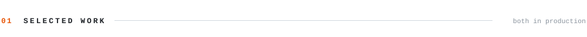
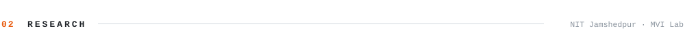
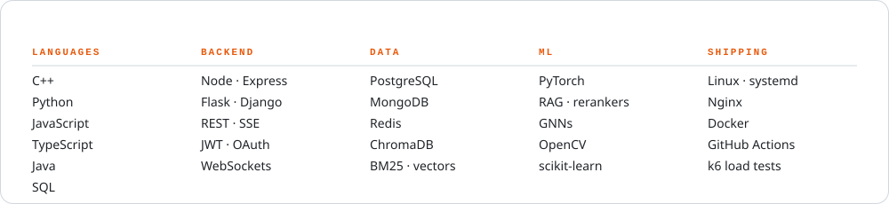

<picture>
  <source media="(prefers-color-scheme: dark)" srcset="assets/hero-dark.svg">
  
</picture>

  <a href="https://openforge.online"><b>openforge.online</b></a> &nbsp;·&nbsp;
  <a href="https://campustrack.openforge.online">campustrack</a> &nbsp;·&nbsp;
  <a href="https://linkedin.com/in/sujalbhatu">linkedin</a> &nbsp;·&nbsp;
  <a href="https://codeforces.com/profile/sujalbhatu">codeforces</a> &nbsp;·&nbsp;
  <a href="mailto:sujalbhatu565@gmail.com">sujalbhatu565@gmail.com</a>

 

<picture>
  <source media="(prefers-color-scheme: dark)" srcset="assets/label-work-dark.svg">
  
</picture>

<a href="https://openforge.online">
  <picture>
    <source media="(prefers-color-scheme: dark)" srcset="assets/openforge-dark.svg">
    
  </picture>
</a>

<a href="https://openforge.online">try it ↗</a> &nbsp; <a href="https://github.com/sujalbhatu/Legal-chatbot">source ↗</a> &nbsp; <a href="https://github.com/sujalbhatu/Legal-chatbot/blob/frontend-redesign/docs/WEEK3_RESULTS.md">how it was measured ↗</a>

<a href="https://campustrack.openforge.online">
  <picture>
    <source media="(prefers-color-scheme: dark)" srcset="assets/rollone-dark.svg">
    
  </picture>
</a>

<a href="https://campustrack.openforge.online">try it ↗</a> &nbsp; <a href="https://github.com/sujalbhatu/Attendence_System">source ↗</a>

<picture>
  <source media="(prefers-color-scheme: dark)" srcset="assets/label-research-dark.svg">
  
</picture>

<picture>
  <source media="(prefers-color-scheme: dark)" srcset="assets/research-dark.svg">
  
</picture>

<a href="https://github.com/sujalbhatu/EEG-channel-classification">GGCS source ↗</a> &nbsp; <a href="https://github.com/sujalbhatu/IRISH">iris source ↗</a>

<picture>
  <source media="(prefers-color-scheme: dark)" srcset="assets/label-tools-dark.svg">
  
</picture>

<picture>
  <source media="(prefers-color-scheme: dark)" srcset="assets/toolbox-dark.svg">
  
</picture>

<picture>
  <source media="(prefers-color-scheme: dark)" srcset="assets/label-more-dark.svg">
  
</picture>

| | |
|---|---|
| **Competitive programming** | 600+ problems · [Codeforces](https://codeforces.com/profile/sujalbhatu) max 1266 · 4th at CodeKarma |
| **Amazon ML Challenge 2026** | [Top 1,000 worldwide](https://github.com/sujalbhatu/Amazon-ML-Hackathon), entity resolution at scale |
| **More builds** | [Bone health classifier](https://github.com/sujalbhatu/Automated-Classification-of-Bone-Health) · [Indian sign language detection](https://github.com/shivapreetham/indian-sign-language-detection) |
| **Off the keyboard** | Mentoring rural school kids for the Navodaya entrance exam with Sankalp Club |
| **Ask me about** | why your RAG hallucinates · SSE vs WebSockets · how many EEG channels you *really* need |

<picture>
  <source media="(prefers-color-scheme: dark)" srcset="assets/signoff-dark.svg">
  
</picture>
